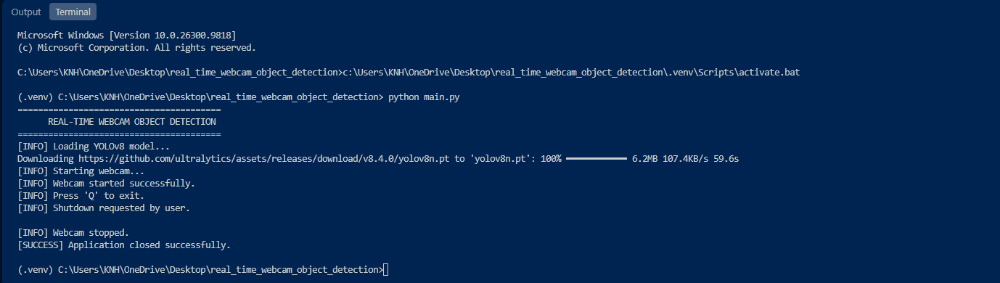

# Real-Time Webcam Object Detection

A real-time object detection application built with **Python, OpenCV, and Ultralytics YOLOv8**. The application captures live video from a webcam, detects objects in each frame, and displays bounding boxes, class labels, confidence scores, and FPS directly on the video stream.

This project demonstrates the practical integration of a pretrained YOLOv8 Nano model into a real-time Computer Vision application.

---

## 1. Project Overview

Real-Time Webcam Object Detection uses a pretrained YOLOv8 Nano model (`yolov8n.pt`) to identify and localize objects from a live webcam feed.

The application continuously captures video frames, sends them to the YOLOv8 detection model, and visualizes the detection results.

The complete detection workflow includes:

1. Load the pretrained YOLOv8 Nano model.
2. Initialize the default webcam.
3. Capture individual video frames.
4. Perform object detection using YOLOv8.
5. Filter detections based on a confidence threshold.
6. Extract predicted object classes and bounding boxes.
7. Draw detection annotations on the video frames.
8. Calculate and display real-time FPS.
9. Display the annotated webcam stream.
10. Release camera resources when the application exits.

The project focuses on real-time object detection and video-based inference rather than model training.

## 2. Key Features

- **Real-Time Webcam Capture:** Continuously captures video frames using OpenCV.
- **YOLOv8 Object Detection:** Uses a pretrained YOLOv8 Nano model for object detection.
- **Bounding Box Visualization:** Automatically draws bounding boxes around detected objects.
- **Class Label Display:** Identifies detected object categories.
- **Confidence Filtering:** Filters predictions using a configurable confidence threshold.
- **Confidence Score Visualization:** Displays detection confidence scores on the video frames.
- **FPS Monitoring:** Calculates and displays frame processing rate.
- **Live Detection Window:** Displays annotated frames in an OpenCV window.
- **Graceful Shutdown:** Supports keyboard-based exit and webcam resource cleanup.
- **Pretrained Model Integration:** Loads the existing `yolov8n.pt` weights file.

## 3. Project Structure

```text
real_time_webcam_object_detection/
│
├── .venv/
│
├── output/
│   ├── record.mp4
│   └── screenshot.png
│
├── main.py
│
├── requirements.txt
│
├── yolov8n.pt
│
└── README.md
```

### Directory and File Description

| File / Directory | Description |
|---|---|
| `.venv/` | Local Python virtual environment. |
| `output/` | Contains project demonstration artifacts. |
| `output/record.mp4` | Recorded demonstration of the real-time webcam object detection application. |
| `output/screenshot.png` | Screenshot documenting the application's execution and detection output. |
| `main.py` | Main application containing webcam capture, YOLOv8 inference, bounding box visualization, and FPS calculation. |
| `requirements.txt` | Lists the required Python dependencies. |
| `yolov8n.pt` | Pretrained YOLOv8 Nano model weights. |
| `README.md` | Project documentation. |

**Output Documentation:** The `record.mp4` file is a recorded demonstration created during manual testing. The current `main.py` displays the real-time video stream but does not automatically record or save video files.

## 4. Technologies and Libraries

| Technology | Purpose |
|---|---|
| Python | Core programming language. |
| OpenCV | Webcam access, frame capture, video display, and text visualization. |
| Ultralytics | YOLOv8 model loading and object detection inference. |
| PyTorch | Deep learning framework used by the YOLO model. |
| YOLOv8 | Real-time object detection architecture. |

## 5. YOLOv8 Model Configuration

This project uses the YOLOv8 Nano model, a lightweight pretrained object detection model.

### Model Information

| Parameter | Configuration |
|---|---|
| Model Architecture | YOLOv8 |
| Model Variant | YOLOv8 Nano |
| Weights File | `yolov8n.pt` |
| Framework | Ultralytics |
| Model Type | Object Detection |
| Input Source | Live Webcam |
| Camera Index | `0` |
| Confidence Threshold | `0.40` |
| Image Size | `640` |
| Visualization | Bounding Boxes, Class Labels, Confidence Scores |
| Performance Monitoring | FPS |

The standard pretrained `yolov8n.pt` checkpoint distributed by Ultralytics is trained on the COCO dataset and supports its predefined object categories.

The model identifies objects within the webcam frame and returns their predicted classes, confidence scores, and bounding box coordinates.

## 6. Detection Configuration

The application uses the following configuration:

```python
MODEL_PATH = "yolov8n.pt"
CAMERA_INDEX = 0
CONFIDENCE_THRESHOLD = 0.40
IMAGE_SIZE = 640
```

### Configuration Description

| Parameter | Description |
|---|---|
| `MODEL_PATH` | Location of the pretrained YOLOv8 model file. |
| `CAMERA_INDEX` | Specifies the webcam device. `0` represents the default camera. |
| `CONFIDENCE_THRESHOLD` | Minimum confidence required for a detection to be retained. |
| `IMAGE_SIZE` | Inference image size passed to the YOLO model. |

The confidence threshold is set to `0.40`, meaning predictions below the configured threshold are filtered out.

## 7. How the Detection Pipeline Works

### 7.1 Load the YOLOv8 Model

```python
model = YOLO(MODEL_PATH)
```

Initializes the pretrained YOLOv8 Nano model using the provided weights file.

### 7.2 Initialize Webcam Capture

```python
camera = cv2.VideoCapture(CAMERA_INDEX)
```

Opens the default webcam using OpenCV.

The application verifies that the webcam is available before starting the real-time processing loop.

### 7.3 Capture Video Frames

```python
success, frame = camera.read()
```

Captures an individual frame from the live webcam stream.

The application checks whether the frame was successfully retrieved before performing inference.

### 7.4 Perform Object Detection

```python
results = model.predict(
    source=frame,
    conf=CONFIDENCE_THRESHOLD,
    imgsz=IMAGE_SIZE,
    verbose=False
)
```

Passes the captured frame to the YOLOv8 model.

The inference operation uses the configured confidence threshold and image size.

### 7.5 Visualize Detection Results

```python
output_frame = results[0].plot()
```

Automatically generates an annotated frame containing:

- Detected object bounding boxes.
- Predicted class labels.
- Confidence scores.

### 7.6 Calculate FPS

```python
current_time = time.time()
elapsed_time = current_time - previous_time

fps = 1.0 / elapsed_time if elapsed_time > 0 else 0.0

previous_time = current_time
```

Calculates the approximate instantaneous processing frame rate based on the elapsed time between consecutive iterations.

The FPS value is displayed directly on the annotated webcam frame.

**Note:** This FPS calculation measures the approximate loop processing rate, not a separately benchmarked or averaged hardware throughput.

### 7.7 Display the Detection Stream

```python
cv2.imshow(
    "YOLOv8 Real-Time Detection",
    output_frame
)
```

Displays the processed webcam frame in an interactive OpenCV window.

### 7.8 Keyboard Controls

```python
if cv2.waitKey(1) & 0xFF in (
    ord("q"), ord("Q"), 27
):
    break
```

The application supports the following exit controls:

| Key | Action |
|---|---|
| `Q` | Exit the application. |
| `q` | Exit the application. |
| `ESC` | Exit the application. |

### 7.9 Resource Cleanup

```python
camera.release()
cv2.destroyAllWindows()
```

Releases the webcam hardware and closes active OpenCV windows when the application terminates.

The cleanup operation is performed through a `finally` block to ensure resources are released even when an exception occurs during execution.

## 8. Real-Time Demonstration

The `output/` directory contains the recorded demonstration and screenshot from the project testing process.

### Recorded Webcam Detection

**Video:** [`output/record.mp4`](output/record.mp4)

The recording demonstrates the application performing live object detection through a webcam, including bounding box visualization, object labels, confidence scores, and FPS.

### Application Screenshot



The screenshot provides visual evidence of the application's real-time detection interface.

## 9. Expected Application Output

When the application runs successfully:

- The YOLOv8 model loads.
- The default webcam opens.
- Live video frames are captured.
- The model detects objects within each frame.
- Bounding boxes and class labels are rendered.
- Confidence scores are displayed.
- FPS information is updated on the video stream.
- The application closes when `Q`, `q`, or `ESC` is pressed.

The detected objects and confidence scores depend on the actual webcam input and model predictions.

## 10. Installation and Setup

### Prerequisites

- Python 3.10 or a compatible Python version supported by the installed Ultralytics and PyTorch releases.
- A working webcam.
- Compatible PyTorch and Ultralytics dependencies.
- Sufficient system resources for real-time inference.

### Step 1 — Clone the Repository

```bash
git clone https://github.com/YOUR_USERNAME/real_time_webcam_object_detection.git
```

Navigate to the project directory:

```bash
cd real_time_webcam_object_detection
```

Replace `YOUR_USERNAME` with your GitHub username.

### Step 2 — Create a Virtual Environment

```bash
python -m venv .venv
```

Activate the environment.

**Windows PowerShell:**

```powershell
.venv\Scripts\Activate.ps1
```

**Windows Command Prompt:**

```cmd
.venv\Scripts\activate
```

**Linux / macOS:**

```bash
source .venv/bin/activate
```

### Step 3 — Install Dependencies

```bash
python -m pip install --upgrade pip
```

Install the required packages:

```bash
pip install -r requirements.txt
```

### Step 4 — Run the Application

```bash
python main.py
```

The application loads `yolov8n.pt` from the project directory and attempts to initialize the default webcam.

Press `Q` or `ESC` to close the application.

## 11. Requirements

The `requirements.txt` file should contain:

```text
ultralytics
opencv-python
```

Ultralytics installs its required deep learning dependencies, including PyTorch. For CUDA-specific installations, follow the official PyTorch installation instructions for the available hardware.

## 12. Current Limitations

- Uses only the default webcam index (`0`).
- Uses a fixed confidence threshold of `0.40`.
- Uses a fixed inference image size of `640`.
- Uses the categories supported by the selected pretrained model.
- Does not perform custom model training.
- Does not automatically save webcam recordings.
- Does not implement webcam device selection through a user interface.
- FPS is an instantaneous loop-rate estimate and may fluctuate.
- Detection quality depends on lighting, camera quality, object visibility, and model capabilities.

## 13. Future Improvements

Potential extensions include:

- Automatic webcam video recording.
- Multiple webcam device selection.
- Real-time object counting.
- Configurable confidence thresholds.
- FPS averaging and performance monitoring.
- GPU device selection and inference benchmarking.
- Custom YOLO model integration.
- Object tracking using tracking algorithms.
- Detection analytics and event logging.
- Graphical user interface integration.

## 14. Learning Outcomes

This project provides practical experience with:

- Integrating pretrained YOLOv8 models into Python applications.
- Real-time webcam capture using OpenCV.
- Object detection inference.
- Bounding box visualization.
- Object class identification.
- Confidence score interpretation.
- Image-size and confidence configuration.
- Real-time video frame processing.
- FPS calculation.
- Camera resource management.
- Building practical Computer Vision applications.

## 15. Author

**Moe Htet Ar Kar (Phoe Cho)**

Machine Learning & Computer Vision Developer

**Technical Focus:**
- PyTorch Deep Learning
- Computer Vision
- OpenCV
- YOLO Object Detection
- Real-Time AI Applications

---

*Developed as part of a practical learning journey in Deep Learning and OpenCV Computer Vision.*